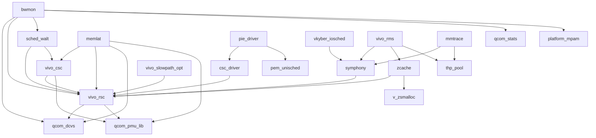

# 方向 6：伴生内核模块与调度器栈

## 0. 范围、方法与证据约定

目标机为 vivo V2505A，设备序列号 `10AFAB03FM003AB`。本次只分析 `vivo_rsc` 之外的指定伴生模块及其控制面；未写入任何设备节点、属性或文件，未加载/卸载模块，未启用 trace，也未改建设备端脚本。

运行内核观察值：

```text
Linux localhost 6.12.58-android16-6-gdd6fd5c98918-abogki543627742-4k #1 SMP PREEMPT ... aarch64 Toybox
```

证据级别：

- **观察**：设备命令输出、运行中节点值、`.ko` 的 ELF/modinfo/符号/重定位/字符串，以及 `/proc/kallsyms` 中保留的符号。
- **推断**：由上述接口名称和加载依赖归纳出的角色或数据流；不表示已观察到一次真实运行时调用。
- **未知**：缺少二进制、缺少单位/协议定义、设备断开前未采集的项目，均明确保留。

主要证据索引（均在本报告所在目录下）：

| 编号 | 文件 | 内容 |
|---|---|---|
| E1 | `kernel_stack/proc_modules.txt` | 完整 `/proc/modules`，含引用计数和 Used-by |
| E2 | `kernel_stack/proc_kallsyms.txt`、`kernel_stack/kallsyms_<模块>.txt` | 完整及按模块拆分的 kallsyms |
| E3 | `kernel_stack/sys_module_inventory.txt` | `/sys/module` 参数与 holders |
| E4 | `ko/*.modinfo.txt`、`ko/*.undefined.txt`、`ko/*.defined.txt` | 三个可取得 `.ko` 的静态接口 |
| E5 | `ko/*.strings.txt`、`ko/*.readelf.txt`、`ko/*.disassembly.txt` | 三个 `.ko` 的字符串、ELF/重定位和反汇编 |
| E6 | `kernel_stack/control_path_search.txt` | 相关 sysfs/procfs 路径的有界搜索结果 |
| E7 | `kernel_stack/control_values.txt` | BGC、zcache、vkyber、meminfo 节点值 |
| E8 | `kernel_stack/csc_values.txt` | CSC 节点值 |
| E9 | `kernel_stack/bandwidth_walt_values_direct.txt` | BWMON 与 WALT 明确叶目录的节点值 |
| E10 | `kernel_stack/memory_symphony_values.txt` | slowpath、zcache proc、Symphony 接口及文件清单样本 |
| E11 | `kernel_stack/trace_formats.txt` | Symphony/vkyber/bwmon/dcvs/schedwalt trace 格式（未启用事件） |
| E12 | `kernel_stack/vendor_module_files.txt` | 跟随符号链接后的 `/vendor/lib/modules` 文件清单 |

## 1. 结论摘要

1. **CPU 调度主链是 `sched_walt + vivo_csc + vivo_rsc`，旁有 `csc_driver`。** `sched_walt` 提供 WALT 负载跟踪、fair/RT 选核、迁移、core control 和 WALT governor；`vivo_csc` 提供 CPU 频率/投票、PID 调节、滚动场景和热限制接口；`csc_driver` 是另一套任务级 heatlimit/action 逻辑，不能与 `vivo_csc` 简单视为同一个文件。
2. **内存带宽主链是 `bwmon → qcom_dcvs → DDR/LLCC/DDRQOS`。** `bwmon.ko` 的 modinfo 和未解析符号直接证明其使用 `qcom_dcvs`、`vivo_rsc`、`sched_walt`、MPAM，并注册 `vivo_fas_register_vote_thres`。
3. **Symphony 不是 CPU 调度策略模块。** 其接口覆盖应用包文件清单、页缓存 prime/vital/fixed 分级、F2FS/EROFS、readahead、块层请求紧急度及三个 misc 设备；应定位为**应用文件预加载/页缓存与 I/O 策略中枢**。
4. **`vivo_bgc` 不是“background compaction”。** 二进制字符串、符号和节点均指向 Binder 冻结状态、同步/异步事务、异步 buffer、阻塞通知及 freeze work。其全称仍未确认。
5. **`vivo_rms` 当前可见职责很窄。** 仅恢复出 `meminfo_version_proc_show`、`meminfo_quick_proc_show` 及初始化函数；不能仅凭 RMS 名称扩张成通用资源管理器。其加载依赖指向 Symphony、zcache 和 thp_pool。
6. **`pem_unisched` 当前更像 CPU 频率 QoS 遥测，而非调度策略。** 可见 `record_cpufreq_info`、频率哈希累计、定时上报和 `pem_freq_qos_update_request`；上报数据格式及消费者内部处理未知。
7. **RSC 是多个平面的共享依赖点，但不是所有模块的上级。** BGC、memdo、pem_unisched 未显示对 RSC 的加载依赖；Symphony、zcache、slowpath、CSC、BWMON 等则显示直接依赖。

## 2. 模块文件、permanent 状态与符号恢复

### 2.1 文件搜索与拉取

`/vendor/lib/modules` 是指向 `/vendor_dlkm/lib/modules` 的符号链接，因此必须跟随链接：

```bash
export MSYS_NO_PATHCONV=1
ADB="D:/Android/SDK/platform-tools/adb.exe -s 10AFAB03FM003AB"
$ADB shell "su -c 'ls -ld /vendor/lib/modules; find -L /vendor/lib/modules -type f'" \
  > analysis/device_pull/perf/kernel_stack/vendor_module_files.txt
```

关键输出：

```text
lrw-r--r-- 1 root root 24 ... /vendor/lib/modules -> /vendor_dlkm/lib/modules
```

对目标名称及 `/system/lib/modules`、`/vendor_dlkm/lib/modules`、`/odm/lib/modules`、`/product/lib/modules`、`/lib/modules` 的有界搜索后，仅发现以下三个目标文件：

| 模块 | 运行状态（E1/E3） | 本地文件 | 字节数 | SHA-256 |
|---|---|---|---:|---|
| `bwmon` | Live，普通模块 | `ko/bwmon.ko` | 122576 | `40c15c13fcbcb2f6916b61a5a6ea39c6e38733665541a4c16bfb93e5472be51e` |
| `vivo_bgc` | Live，`[permanent]` | `ko/vivo_bgc.ko` | 56472 | `6184f0bc7ae3cf29b6a91c385d6d65ee4440ad8fc3c2e3568033f6db892fa25d` |
| `vivo_csc_debug` | `/sys/module` 中不存在，未加载 | `ko/vivo_csc_debug.ko` | 69264 | `7e34ce4c10a9ce69c5ff76d4d4d192ff8514646e09cce934a95585599e79cb8f` |

普通 `adb pull` 因 shell 权限返回 `Permission denied`，改用只读 root `cat` 输出到本地，未在设备端创建文件：

```bash
$ADB exec-out "su -c 'cat /vendor/lib/modules/bwmon.ko'" > analysis/device_pull/perf/ko/bwmon.ko
$ADB exec-out "su -c 'cat /vendor/lib/modules/vivo_bgc.ko'" > analysis/device_pull/perf/ko/vivo_bgc.ko
$ADB exec-out "su -c 'cat /vendor/lib/modules/vivo_csc_debug.ko'" > analysis/device_pull/perf/ko/vivo_csc_debug.ko
```

其余 11 个目标运行模块在上述标准目录未找到同名 `.ko`。这**不等于证明其为内联模块**：也可能是启动映像内模块或加载来源已不可见；本次未解包 boot/vendor_boot，来源保持未知。

### 2.2 permanent 模块与 kallsyms

E1 明确标出三个目标 `[permanent]`：

```text
vivo_bgc 45056 0 [permanent], Live ... (O)
vivo_rms 16384 0 [permanent], Live ... (O)
vivo_memdo 28672 0 [permanent], Live ... (O)
```

导出并拆分：

```bash
$ADB shell "su -c 'cat /proc/kallsyms'" > analysis/device_pull/perf/kernel_stack/proc_kallsyms.txt
# 本地按行尾的 [module_name] 拆成 kallsyms_<module>.txt
```

恢复条目数（包含 `$x/$d`、trace、alloc-tag 等编译器辅助符号，不等于函数数）：

| 模块 | 条目数 | 模块 | 条目数 |
|---|---:|---|---:|
| vivo_csc | 1460 | csc_driver | 195 |
| vivo_csc_debug | 0（未加载） | symphony | 1264 |
| vkyber_iosched | 346 | vivo_rms | 24 |
| zcache | 511 | vivo_slowpath_opt | 715 |
| sched_walt | 4667 | bwmon | 540 |
| qcom_dcvs | 545 | pem_unisched | 39 |
| vivo_memdo | 72 | vivo_bgc | 183 |

本次 kallsyms 地址均为 `0000000000000000`，所以只使用符号名、类型和模块标签，不声称恢复运行地址。

### 2.3 静态分析工具

使用本机 NDK `26.3.11579264` 的 `llvm-readelf`、`llvm-nm`、`llvm-strings`、`llvm-objdump`，分别生成 E4/E5。三个模块的 modinfo 关键内容：

```text
bwmon: description=QCOM BWMON driver
bwmon: depends=qcom-dcvs,vivo_rsc,qcom_stats,platform_mpam,sched-walt
bwmon: parmtype=dump_vote_en:int

vivo_bgc: name=vivo_bgc
vivo_bgc: depends=

vivo_csc_debug: description=vivo csc module for debug
vivo_csc_debug: parm=debug_func:Debug level (0-1000)
vivo_csc_debug: depends=
```

## 3. 逐模块角色与证据

### 3.1 `sched_walt`：CPU 负载核算、选核/迁移与频率 governor

**观察：**

- E2 有 `walt_update_task_ravg`、`walt_select_task_rq_fair`、`walt_select_task_rq_rt`、`walt_find_busiest_queue`、`walt_newidle_balance`、`waltgov_update_freq`、`waltgov_next_freq_shared`。
- 还有 core control（`show_min_cpus`、`show_active_cpus`）、pipeline、frame rate、RTG、RSC 专用 `rsc_find_rt_allowmask`、`rsc_game_allowmask_get` 等接口。
- E3 参数：`rsc_first_candidate_pid=-1`、`rsc_second_candidate_pid=-1`。
- E9 两个控制目录为 `/sys/devices/system/cpu/cpufreq/policy0/walt` 和 `policy6/walt`；两者 `boost=-8`、`hispeed_load=90`、`up_rate_limit_us=1000`，`rtg_boost_freq` 分别为 `787200` 和 `864000`。节点未同时给出单位，本报告不换算。
- E11 的 `waltgov_next_freq`、负载均衡、选核等 trace format 与上述角色一致；未启用这些事件。

**推断：** 这是高通 WALT 调度底座，向上承接 vivo CSC/RSC 的任务分类和 mask，向下影响 CPU 选核、迁移、online 核数及频率。加载依赖上 `sched_walt → vivo_rsc` 且 `sched_walt → vivo_csc`，不是“vivo_csc 单向调用 WALT”这么简单。

### 3.2 `vivo_csc`：CPU 频率/调度控制与场景投票

**观察：**

- E2 有 `csc_android_vh_scheduler_tick`、`cpu_active_ratio_cap`、完整 `show/store_csc_pid_{target,kp,ki,kd}`、`update_adaptive_boost_freq`、`update_adaptive_floor`、`uclamp_task_{time,load}`。
- 场景接口包括 `csc_fas_scroll`、`csc_fas_scroll_monitor`、heatlimit QoS/slots 和 `cpu_core_freq_*`。
- E8 当前 `/sys/kernel/vivo_csc` 分为 `csc_pid`、`csc_vote`、`csc_scroll`、`csc_heatlimit`。
- 每核 PID 值均为 `kp=512`、`ki=16`、`kd=256`、`target=350`；`scroll_draw_min` 和 `scroll_no_draw_min` 当前每核均为 0。
- `cpufreq_low` 对 CPU0–5 为 `1593600`、CPU6–7 为 `1766400`；`cpufreq_high` 分别为 `2035200` 和 `2284800`；节点未附单位。
- heatlimit 当前 `heatlimit_qos=4294967295`、`heatlimit_set` 为 `pid:0 max:0`，slots 全 `-1`。
- E1/E3 显示 `memlat`、`sched_walt` 持有 `vivo_csc`；`vivo_csc` 又持有 `vivo_rsc` 和 `qcom_pmu_lib`。

**推断：** 可确认其是 CPU 调度/频率控制模块，负责将场景、负载和热限制转为频率/投票调节。**“CSC = CPU Scheduler Controller”的全称没有直接字符串证据，仍属命名推测。**

### 3.3 `csc_driver`：任务级 heatlimit/action 执行器

**观察：**

- E2 有 `csc_wake_up_new_task`、`csc_task_rename`、`action_scheduler_tick`、`action_task_add/del/show`、`task_sleep_timeout`。
- 功耗/热限制相关符号有 `update_power_work`、`update_power_handler`、`get_task_init_power`、`heatlimit_proc_{open,read}`、`heatlimit_write_proc`、`heatlimit_thread_fork`、`heatlimit_task_rename`。
- E8 只读到 `/proc/csc/heatlimit`，当前为空。
- E1/E3 显示 `csc_driver → vivo_rsc`；`pie_driver → csc_driver`。

**推断：** 它更偏向按任务/命令行追踪并执行热限制动作，不是 `vivo_csc` 的简单别名。`action` 的具体动作集合和 `update_power` 算法缺少 `.ko`，未能确认。

### 3.4 `vivo_csc_debug`：未加载的 CSC 调试探针

**观察：**

- 文件存在但未加载，E2 因而没有运行符号。
- E4/E5 有 `debug_set_cpus_allowed_ptr`、`csc_android_rvh_set_cpus_allowed_ptr`、`csc_cpu_frequency_limits`、`csc_uclamp_eff_get`、`csc_freq_qos_update_request`。
- 字符串引用 `android_rvh_set_cpus_allowed_ptr`、`android_vh_setscheduler_uclamp`、`cpu_frequency_limits`，并记录 PID、comm、cpumask 和频率上下限。
- 源路径字符串为 `../soc-repo/kernel/sched/vivo_csc/vivo_csc_debug.c`。

**推断：** 这是用于观察 CSC/调度事件的独立调试模块，不应计入当前生效调度链。其静态接口存在不代表当前节点或回调已注册。

### 3.5 `bwmon`：DDR/LLCC 带宽测量与投票来源

**观察：**

- E4 的 `depends=qcom-dcvs,vivo_rsc,qcom_stats,platform_mpam,sched-walt` 是最直接的依赖证据。
- 未解析符号包括 `mpam_get_byte_count`、`qcom_dcvs_register_voter`、`qcom_dcvs_update_votes`、`qcom_dcvs_hw_minmax_get`、`vivo_fas_register_vote_thres`、`cpufreq_cpu_get_raw`。
- 字符串和定义符号包含 `bwmon-ddr`、`bwmon-llcc-gold`、`bwmon-llcc-prime`、`bwmon_monitor_work`、`bwmon_intr_thread`、`show/store_*` 完整属性组。
- E9 实际设备为 DDR、LLCC gold、LLCC prime，均位于 `/sys/devices/system/cpu/bus_dcvs/`。
- 快照值：DDR `min_freq=547000`、`max_freq=3187000`、`cur_freq=3187000`、`avgbw_enable=0`；LLCC gold `min_freq=282000`、`max_freq=806000`、`cur_freq=1350000`、`use_sched_boost=1`、`sched_boost_freq=1350000`；LLCC prime `cur_freq=806000`、`use_sched_boost=0`。频率单位未由节点文本明确给出。
- E11 的 `bw_hwmon_mpam` 同时带 `bwmon_mbps/raw_mpam_mbps/fixed_mpam_mbps/fixed_mbps`，`bwmon_gold_noc_mpam_data` 带 gold/prime/gpu/nsp 数据字段。

**推断：** BWMON 将硬件/MPAM 带宽测量转换为 DCVS 投票；vivo FAS 通过注册阈值关系参与其调频决策。它不是 CPU 选核器，而是内存带宽调频输入端。

### 3.6 `qcom_dcvs`：DDR/LLCC/DDRQOS 投票汇聚与硬件路径

**观察：**

- E2 导出/定义 `qcom_dcvs_register_voter`、`qcom_dcvs_update_votes`、`qcom_dcvs_unregister_voter`、`qcom_dcvs_hw_minmax_get` 和 `qcom_dcvs_kobject_get`。
- E6 有 `/sys/devices/system/cpu/bus_dcvs/{DDR,DDRQOS,LLCC}`，以及 platform 设备 `soc:qcom,dcvs:{ddr,ddrqos,llcc}:sp`。
- 根目录存在 `hw_min_freq`、`hw_max_freq`、`available_frequencies`、`bwmon_freqvote_ms`、`icc_freqvote_ms`。
- E11 的 `qcom_dcvs_update` 字段为 `name/hw/path/ib/path_ib/ab/path_ab/boost_freq`，`qcom_dcvs_boost` 字段为 `hw/path/boost/path_ib/path_ab`。
- E1 显示 `msm_kgsl`、`bwmon`、`memlat`、`vivo_rsc` 均持有 `qcom_dcvs`。

**推断：** 它是多个投票者到 DDR/LLCC/DDRQOS 硬件频率路径的汇聚层，而非 vivo 私有任务调度器。

**未补采：** 最后读取根目录频率表和上下限时设备从 `adb devices` 消失，故不填这些值。已存在的 BWMON 叶节点值不受影响。

### 3.7 `symphony`：应用文件预加载、页缓存分级与 I/O 策略中枢

**观察：**

- E3 参数：`pcache_en=Y`、`pcache_ver=2.0`、`z_enable=Y`、`min_file=102400`、`max_prime=25600`、`max_vital=184320`、`prime_limit=12800`、`recycling=<5>, 1250, 250`。参数含义/单位未全部确认。
- E2 有 `add_package/config_package`、`mark_{basic,dex,tiny}_folio`、`pcache_set_inode`、`__async_readahead`、`__tune_readaround`。
- 页缓存分级符号包括 `prime/vital/fixed_shrink_{count,scan}`、`num_prime_pages`、`num_vital_pages`、`num_fixed_pages`，以及 LRU/memcg 相关钩子。
- 文件系统/块层符号包括 F2FS data/meta page、EROFS namei/readdir/read_folio、`check_rq_urgency`、`__blk_mq_alloc_driver_tag_pre`。
- 三个 misc 设备为 `/dev/symphony-cmd`（10:274）、`/dev/symphony-app-cmd`（10:275）、`/dev/symphony-entry`（10:276），对应 `cmd_ioctl`、`app_cmd_ioctl`、`entry_read/poll`。
- `/proc/symphony/<包名>/{entry,offset}` 当前存在。E10 的 Settings 样本逐行记录 `数值|数值|字节大小|路径`，路径包括 `boot.oat`、Settings.apk、GameCube.apk、SO、字体、dex/vdex 等。前两列含义未确认。
- E1/E3 显示 `mmtrace`、`vivo_rms`、`vkyber_iosched` 持有 Symphony；`symphony → vivo_rsc`。
- Symphony 内部还有 `set_rsc_qos_dynamic`、`clear_rsc_qos_dynamic` 包装符号。

**推断：** 用户态通过 misc/proc 接口配置应用文件集合，Symphony 在文件访问、缺页、readahead、LRU 回收和块 I/O 路径上保留/分级关键页，并把任务/请求紧急性与 RSC QoS、vkyber 连接起来。它不是“CPU 调度策略”模块。

### 3.8 `vkyber_iosched`：启用中的 vivo Kyber 块 I/O 电梯

**观察：**

- E2 有 `kyber_insert_requests`、`kyber_dispatch_request`、`kyber_completed_request`、`kyber_limit_depth`、`calculate_percentile` 和 read/write latency/token 属性。
- E7 对 `sda/sdb/sdc` 均为 `none mq-deadline kyber bfq [vkyber]`，即 vkyber 是当前电梯。
- 三者当前相同：`min_depth=8 8 1 1`、`read_lat_nsec=2000000`、`write_lat_nsec=10000000`。
- E11 定义 `vkyber_latency`（domain/type/percentile/samples）、`vkyber_adjust`（domain/depth）、`vkyber_throttled`。
- E1/E3 显示 `vkyber_iosched → symphony`。

**推断：** 它是 Kyber 风格延迟/token 电梯的 vivo 改造版，利用 Symphony 的任务/I-O 紧急性信息；具体改造算法未恢复，不能仅按上游 Kyber 推断全部细节。

### 3.9 `vivo_rms`：meminfo 快速/版本化读取与内存模块组合者

**观察：**

- E2 仅 24 条，业务函数只有 `meminfo_version_proc_show`、`meminfo_quick_proc_show`、`meminfo_version_init`、`meminfo_quick_init`。
- E7：`/proc/meminfo_version` 为 `2001 0 0`；`/proc/meminfo_quick` 为一行数值快照，字段定义未恢复。
- E1/E3：`vivo_rms → symphony`、`vivo_rms → zcache`、`vivo_rms → thp_pool`。特别注意 zcache 的 holders 是 `vivo_rms`，方向不是反向。
- 当前标记为 `[permanent]`。

**推断：** 当前证据支持“内存信息读取/聚合及组合 vivo 内存功能”的窄角色，不能确认 RMS 全称或宣称其统一调度 CPU/I/O。

### 3.10 `zcache`： cleancache/F2FS 文件页压缩缓存

**观察：**

- E2 有 `zcache_cleancache_register_ops`、`zcache_store_page`、`zcache_load_page`、`zcache_flush_inode/fs`、`zcache_f2fs_init_fs`、`zcache_{store,shrink}_thread`、压缩/zbud/zs_pool 符号。
- E3 模块参数 `clear_percent=3`、`max_pool_percent=9`。
- E7 的 `/sys/zcache/stored_enable`：`main_switch=0`、`stored_enable=1`、`nr_used_pools=0`、`sync_stored_enable=1`；`delay=3000`、`fsize=5242880`、`version=2`。
- `/proc/zcache` 当前 `zcache_pool_pages=0`、`zcache_stored_pages=0`、命中/压缩大小均为 0，`zcache_store_thread_wakeup_times=4`。
- `bindcore/compress/shrink` 读取为 Permission denied，按写专用接口处理，未尝试写入。
- E1：`zcache → vivo_rsc`、`zcache → v_zsmalloc`；`vivo_rms → zcache`。

**推断：** 它主要是文件页/cleancache 方向的压缩缓存，不应与 zram swap 或 BGC 混为一谈。当前主开关为 0 且池为空，说明此刻未观察到已存页，但不证明从未运行。

### 3.11 `vivo_slowpath_opt`：RSC QoS 驱动的内存分配慢路径优化

**观察：**

- E2 有 `throttle_direct_reclaim_bypass`、`pagecache_ra_order_bypass`、`alloc_pages_adjust_wmark`、`memqos_page_pool_{alloc,refill}`、`memqos_lock_mask`、`memqos_wall`、`qos_change_reset_wmark`。
- 另有 `mdb_slowpath_count`、`count_workingset_refault`、folio lock owner boost/restore 统计。
- E10 控制面位于 `/sys/rsc/slowpath_opt`，包括 `memqos_{page_pool,wmark,wall,lock}` 和 `amm_walk`。
- 当前 `slowpath_opt_enable=1`、`rsc_qos_enable=1`、各 QoS slowpath stall 均为 0；page pool 为 movable 2560、unmovable 2560、reclaimable 213 页。
- `memqos_wmark_enable=1`，总/低 QoS/中 QoS 最大 slowpath 任务分别为 32/8/2；`memqos_lock_mask=0x6`，文本明确为 mmap read/write lock。
- E1/E3：`vivo_slowpath_opt → vivo_rsc`。

**推断：** 它按 RSC QoS 区分任务，在分配、直接回收、readahead、水位、页池和 mmap 锁等待等慢路径上优化关键任务，不是 CPU 调度器。

### 3.12 `vivo_memdo`：kswapd/分配失败/温度内存观测守护

**观察：**

- E2 有 `kswapd_running_{start,end}_hook`、`alloc_fail_show_mem_hook`、`kvbmd_loop`、`vbmeminfo_proc_show`、`init_adjust_zone_wmark_hook`。
- 还保留 `thermal_zone_get_zone_by_name`、`thermal_zone_get_temp` 地址解析符号及 `pagealloc_fail_count`。
- E7 的 `/proc/vbmeminfo`：`kswapd_usage=2`、`kswapd_bigusage=0`、`quiet_therm=38082`、`pagealloc_fail=0`。`quiet_therm` 单位未确认，不能仅按常见热节点单位换算。
- 当前为 `[permanent]`，E1/E3 未显示 holders 或对目标模块的加载依赖。

**推断：** 这是内存回收状态观测和记录模块，可能给 vivo 内存管理提供输入；未观察到它直接控制 CPU 调度。

### 3.13 `vivo_bgc`：Binder 冻结/阻塞与大异步事务处理

**观察：**

- E5 字符串含 `vivo_bgc_binder_frozen_callback.c`、`register_binder_frozen_callback_vendor_hooks`、`register_binder_event_vendor_hooks`、`register_binder_block_query_vendor_hooks`。
- E2/E5 有 `binder_trans_hook`、`binder_preset_hook`、`android_vh_binder_alloc_new_buf_locked_hook`、`notify_app_binder_freez`、`binderfreez_aync_notify_read_out`、`cgroup_freezing_or_frozen`。
- 日志格式明确区分 sync/async binder 到 frozen UID/PID，并记录事务大小、allocated buffer 和 free async space。
- E7 的 `/sys/vivo_bgc/binder_cmd` 为 `Binder Blocked Notify: STARTED`；`binder_frozen_callback_cmd` 为 `enabled: 1`。
- `/sys/vivo_bgc` 还含 `binder_event`、`binder_frozen_callback`；`/proc/vivo_bgc/binder_block_query` 当前为空。
- `.modinfo depends=` 为空，E1/E3 未显示对 RSC 的依赖；当前为 `[permanent]`。

**推断：** 它在 Binder 目标冻结时监测/记录事务，并参与 freeze work 和阻塞通知。**没有证据支持“BGC = background compaction”；本报告不采用该解释。** BGC 英文展开仍未知。

### 3.14 `pem_unisched`：CPU 频率 QoS 请求统计/定时上报

**观察：**

- E2 有 `record_cpufreq_info`、`cpu_freq`、`freq_hash_table`、`hash_freq_sum`、`report_timer`、`report_timer_handler`、`pem_freq_qos_update_request`。
- E1 显示 `pie_driver → pem_unisched`；pem_unisched 自身未显示 holders。
- 有界路径搜索未找到其独立 sysfs 控制目录或模块参数。

**推断：** 当前更像性能事件/频率请求遥测模块，向 `pie_driver` 所在体系提供统计，而非独立调度决策器。上报目的端、频率哈希语义、定时周期及协议未知。

## 4. 控制面总览

| 平面 | 已观察接口 | 当前快照要点 |
|---|---|---|
| CSC | `/sys/kernel/vivo_csc/*`、`/proc/csc/heatlimit` | PID/频率 vote/scroll/heatlimit；详见 E8 |
| WALT | `cpufreq/policy{0,6}/walt` | boost、hispeed、rate limit、RTG 等；详见 E9 |
| BWMON/DCVS | `/sys/devices/system/cpu/bus_dcvs/*` | DDR、LLCC gold/prime 调频属性与 DCVS 根属性；详见 E9 |
| Symphony | `/dev/symphony-{cmd,app-cmd,entry}`、`/proc/symphony/<pkg>/*` | 包文件集合和事件/命令接口；详见 E10 |
| vkyber | `/sys/block/sd[a-c]/queue/{scheduler,iosched/*}` | 当前电梯及延迟目标；详见 E7 |
| zcache | `/sys/zcache/*`、`/proc/zcache{,_quick}` | 开关、池、压缩/回收统计；详见 E7/E10 |
| slowpath | `/sys/rsc/slowpath_opt/*` | QoS 页池、水位、mmap 锁、wall 等；详见 E10 |
| RMS/memdo | `/proc/meminfo_{version,quick}`、`/proc/vbmeminfo` | 只读内存快照；详见 E7 |
| BGC | `/sys/vivo_bgc/*`、`/proc/vivo_bgc/binder_block_query` | Binder 通知/冻结回调；详见 E7 |
| pem_unisched | 未找到独立控制目录 | 只有 kallsyms 和加载依赖证据 |

`/sys/class` 下未找到 CSC 对应项；CSC 的实际控制根是 `/sys/kernel/vivo_csc`，不是假想的 `/sys/class/csc*`。

## 5. 模块依赖图（静态加载关系）

图例：`A --> B` 表示 **A 持有/依赖 B**，由 E1 的 Used-by 反向解读、E3 holders 或 E4 modinfo 得到；不表示已观察到运行时调用。



`vivo_bgc`、`vivo_memdo` 在上述目标集合中独立；`pem_unisched` 只显示被 `pie_driver` 使用。`vivo_csc_debug` 未加载且 modinfo 无 depends。

## 6. 功能数据流图（基于接口的归纳）

实线是有静态接口/节点支撑的路径；虚线表示消费者内部协议或精确运行时顺序尚未恢复。

```text
任务运行/负载
   └─> sched_walt（ravg、fair/RT 选核、迁移、core control、WALT governor）
         └─> vivo_csc（PID、频率 vote、scroll、heatlimit）
               └─> vivo_rsc / qcom_pmu_lib / cpufreq 相关路径

MPAM 与带宽硬件计数
   └─> bwmon（DDR、LLCC gold/prime 测量）
         └─> qcom_dcvs（ib/ab/boost 投票汇聚）
               └─> DDR / DDRQOS / LLCC 硬件频率路径
   vivo FAS --注册 vote threshold 关系--> bwmon

用户态包/文件配置
   └─> /dev/symphony-* 与 /proc/symphony/<pkg>/*
         └─> Symphony（文件集合、prime/vital/fixed 页、readahead、F2FS/EROFS）
               ├─> 页缓存/LRU/memcg 与块 I-O 紧急度
               ├─> vkyber_iosched（延迟/token/队列深度）
               └─> RSC QoS 包装接口

RSC QoS
   └─> vivo_slowpath_opt
         └─> 直接回收/readahead/水位/页池/mmap 锁/folio owner 路径

Binder vendor hooks
   └─> vivo_bgc
         ├─> 冻结回调与 freeze work
         ├─> 同步/异步事务及异步 buffer 记录
         └─> /sys/vivo_bgc 通知、/proc/vivo_bgc 查询

kswapd、page alloc fail、thermal 输入
   └─> vivo_memdo
         └─> /proc/vbmeminfo

CPU 频率 QoS 更新
   └─> pem_unisched（记录/哈希累计/定时上报）
         └─> pie_driver 内部处理（未知）
```

## 7. 未知项与后续建议

1. **11 个运行模块缺少同名 `.ko`。** 当前只恢复 kallsyms，无法做函数级反汇编；若需确认算法，应后续只读解包与运行内核完全匹配的 boot/vendor_boot/init_boot 映像并核对构建 ID。
2. **kallsyms 地址被清零。** 当前符号用于接口命名和模块归属，不能用于地址级交叉引用。
3. **DCVS 根节点值未补全。** 设备在最后补采前断开 adb；路径已确认，但 `available_frequencies`、硬件上下限及 vote ms 当前值未知。
4. **简称不能强行展开。** CSC、RMS、BGC 的英文全称均未由字符串确认；本报告只给可证角色。
5. **Symphony 协议细节未知。** `/proc/<pkg>/entry` 前两列、三个 misc 设备的 ioctl 命令结构、prime/vital/fixed 精确语义仍需匹配二进制或用户态协议。
6. **pem_unisched 上报协议未知。** 已确认记录/累计/定时器符号，但未确认数据发送方式、周期和 pie_driver 的消费逻辑。
7. **依赖图不是运行时 trace。** 本任务未启用任何事件；FAS、CSC、RSC 之间的精确调用顺序和频率需要另行只读跟踪验证。
8. **节点值为瞬时快照。** 特别是 cur_freq、池页数、任务计数和开关状态，不应视为永久配置。

## 8. 只读性核验

所有设备命令均为 `cat/ls/find/uname` 或读取 `/proc`、`/sys`；`adb exec-out su -c cat` 仅用于取得模块字节。读取写专用节点时出现的 `Permission denied` 被保留，未通过写入绕过。未执行 `echo >`、`setprop`、`insmod`、`rmmod`、`chmod/chown`、trace enable 或服务启停。
