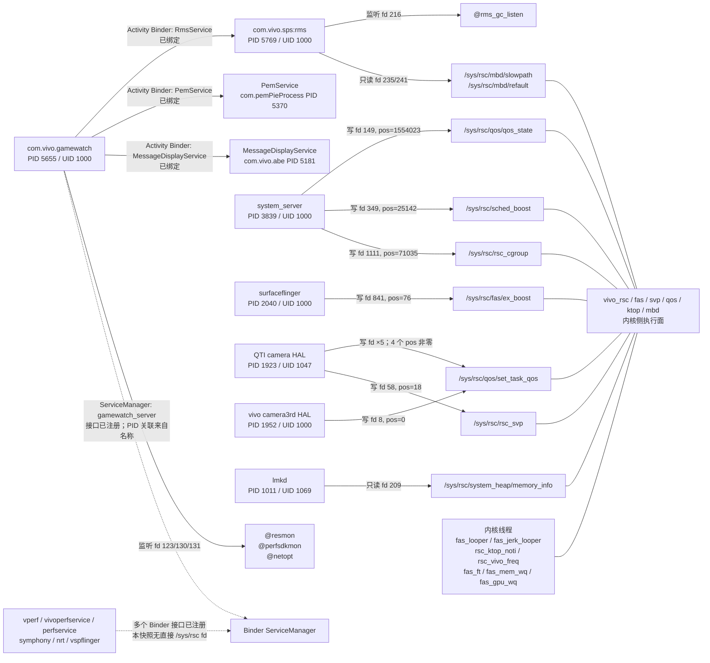

# 方向4：vivo 性能调度运行时进程拓扑与 `/sys/rsc` 打开者/写入者确认

## 1. 范围、设备与证据口径

- 设备：vivo V2505A，serial `10AFAB03FM003AB`。
- 固件观察值：`vivo/PD2505/PD2505:17/CP2A.260605.016_V000L1/261022204808:user/release-keys`，Android 17，SDK 37。
- 内核观察值：`6.12.58-android16-6-gdd6fd5c98918-abogki543627742-4k`，aarch64。
- 采集时间：2026-11-06 16:58—17:04 CST；目标进程二次核对时间为 `Fri Nov 6 17:04:06 CST 2026`。
- 身份与 root 证据：`analysis/device_pull/perf/runtime_topology/identity.txt:1`、`analysis/device_pull/perf/runtime_topology/perf_process_cmdlines.txt:1`。
- 全部操作均为 `ps`、读取 `/proc`、`dumpsys`、`service list`、`pm path`、`logcat -d` 等只读观察；未写入任何设备节点、属性或文件。
- 本文将【观察】（命令直接输出或由 inode 精确关联）、【推断】（名称或非零位置所支持的解释）和【未知】严格分开。进程与 fd 都是快照，短命的 `open → write → close` 不会留在 fd 快照中。

原始证据统一保存在 `analysis/device_pull/perf/runtime_topology/`。

## 2. 核心结论

1. 【观察】精确扫描 `/proc/[0-9]*/fd` 后，只有 6 个进程在本快照中直接持有 `/sys/rsc/**` fd：`lmkd`、`vendor.qti.camera.provider-service_64`、`vendor.vivo.hardware.camera3rd.provider@1.0-service`、`surfaceflinger`、`system_server`、`com.vivo.sps:rms`。
2. 【观察】其中 `system_server`、`surfaceflinger` 和两个相机 HAL 的 fd 是写模式；`lmkd` 与 `com.vivo.sps:rms` 是读模式。`com.vivo.gamewatch`、vperf 系列、`vivonrtservice`、`deformer`、`upslide` 在此快照中没有直接 `/sys/rsc` fd。
3. 【强迹象，非实时 syscall 证明】多个写 fd 的 `pos` 非零：`system_server` 的 `qos_state=1554023`、`sched_boost=25142`、`rsc_cgroup=71035`；`surfaceflinger` 的 `fas/ex_boost=76`；高通相机 HAL 的多个 `set_task_qos` fd 位置为 13、1443、22、52，`rsc_svp=18`。这与此前发生过写入一致，但理论上文件位置也可由 `lseek` 推进，且本次未跟踪 `write(2)`。
4. 【观察】GameWatch 的直接通信面很清楚：它监听 `@resmon`、`@perfsdkmon`、`@netopt` 三个抽象 Unix socket，并通过 Activity Binder 绑定 `RmsService`、`PemService`、`MessageDisplayService`。
5. 【观察】`com.vivo.sps:rms` 同时是 GameWatch 的 `RmsService` 服务端、`@rms_gc_listen` 的监听者，以及 `/sys/rsc/mbd/{slowpath,refault}` 的只读打开者。这是本快照中最明确的一条“GameWatch → Binder → RMS → `/sys/rsc/mbd`（读）”拓扑链；没有证据证明 GameWatch 经 RMS 写 `/sys/rsc`。
6. 【观察】GameCube 当时没有进程，`dumpsys activity services/broadcasts` 也没有其活动 ServiceRecord 或动态 ReceiverList；但 `pm path com.vivo.gamecube` 确认 APK 已安装。GameKit、GameLib、gamespace 同样已安装但未见同名运行进程。
7. 【观察】`service list` 注册了 `gamewatch_server`、`game_manager`、`qos`、`vboost`、vperf/perf 系列等 Binder 接口。仅凭 `service list` 不能恢复每个 ServiceManager 服务的宿主 PID；本文不会把名称相似当作 PID 所有权证明。

## 3. 进程清单：PID、PPID、UID、cmdline

### 3.1 用户态性能相关进程

证据主文件：

- 全量 `ps`：`analysis/device_pull/perf/runtime_topology/ps_all.txt`
- 二次 `/proc/<pid>/cmdline` 与 `status`：`analysis/device_pull/perf/runtime_topology/perf_process_cmdlines.txt`

| 进程/cmdline | PID | PPID | UID | 证据 |
|---|---:|---:|---:|---|
| `/vendor/bin/hw/vendor.qti.hardware.perf2-hal-service` | 1937 | 1 | 0 | `perf_process_cmdlines.txt:2` |
| `/vendor/bin/hw/vendor.vivo.hardware.vperf-service-aidl` | 1969 | 1 | 0 | `perf_process_cmdlines.txt:10` |
| `/system/bin/vivoperfservice` | 2946 | 1 | 1000 | `perf_process_cmdlines.txt:18` |
| `/system/bin/vivosymphonyservice` | 2959 | 1 | 0 | `perf_process_cmdlines.txt:26` |
| `/system/bin/vspflinger` | 2960 | 1 | 0 | `perf_process_cmdlines.txt:34` |
| `/system_ext/bin/perfservice` | 2961 | 1 | 1000 | `perf_process_cmdlines.txt:42` |
| `/system/bin/vivonrtservice` | 3552 | 1 | 1000 | `perf_process_cmdlines.txt:50` |
| `com.vivo.sps` | 5054 | 1740 | 1000 | `perf_process_cmdlines.txt:58` |
| `com.vivo.deformer` | 5238 | 1740 | 10308 | `perf_process_cmdlines.txt:66` |
| `com.vivo.upslide` | 5324 | 1740 | 1000 | `perf_process_cmdlines.txt:74` |
| `com.vivo.gamewatch` | 5655 | 1740 | 1000 | `perf_process_cmdlines.txt:82` |
| `com.vivo.sps:rms` | 5769 | 1740 | 1000 | `perf_process_cmdlines.txt:90` |

另有一个名称命中但**不是 vivo 官方组件**的进程：

- `/data/user/0/com.omarea.vtools/files/scene-daemon`，PID 29618，PPID 1，UID 0，证据 `perf_process_cmdlines.txt:98`。它属于第三方 `com.omarea.vtools`，本快照没有直接 `/sys/rsc` fd，不应并入官方调度链路。

【边界】上述清单按 `perf|game|qvr|deformer|upslide|nrt|scene-daemon|com.vivo.sps|fas|rsc|vapt|vboost|vsp` 等关键词从全量 `ps` 中筛选，完整原始表保留以便复查；“全部”仅指本次快照与关键词范围，不排除其他名称的辅助组件。

### 3.2 未观察到同名运行进程

- `com.vivo.gamecube`
- `com.vivo.gamekit`
- `com.vivo.gamelib`
- `com.vivo.gamespace`
- `com.vivo.gpudrivers`
- qvr 相关进程

`pm path` 结果（`analysis/device_pull/perf/runtime_topology/package_paths.txt:1`）：

```text
com.vivo.gamewatch  -> /system/app/GameWatch/GameWatch.apk
com.vivo.gamecube   -> /system/app/GameCube/GameCube.apk
com.vivo.gamekit    -> /system/app/GameKit/GameKit.apk
com.vivo.gamelib    -> /system/app/GameLib/GameLib.apk
com.vivo.gamespace  -> /system/app/vivogamespace/vivogamespace.apk
com.vivo.gpudrivers -> 无输出
```

【未知】`com.vivo.gpudrivers` 的 `pm path` 无输出只说明这个精确包名未解析，不能排除 GPU 驱动使用其他包名；未运行也不代表这些包在其他场景不会启动。

### 3.3 内核侧可见线程

【观察】`ps_all.txt:223`—`ps_all.txt:231`：

```text
403  [fas_looper]
404  [rsc_ktop_noti]
405  [fas_jerk_looper]
406  [kworker/R-fas_ft]
407  [kworker/R-fas_mem_wq]
408  [kworker/R-fas_gpu_wq]
409  [vapt_looper]
411  [rsc_vivo_freq]
```

这些线程 PPID 均为 2、UID 均为 0。它们证明内核中存在以 fas/rsc/vapt 命名的执行上下文；线程名本身不证明具体算法或模块调用关系。

## 4. `/sys/rsc` 打开者与写入者证据

### 4.1 为什么不能直接采用宽泛 `grep rsc`

任务给出的宽泛扫描会同时命中 `/proc/vivo_rsc/frame_set_priority`，以及路径中包含 `rsc` 的无关文件。原始对照保存在 `analysis/device_pull/perf/runtime_topology/fd_broad_rsc_false_positives.txt`。

例如：

```text
com.vivo.deformer -> /proc/vivo_rsc/frame_set_priority
com.vivo.upslide  -> /proc/vivo_rsc/frame_set_priority
```

见 `fd_broad_rsc_false_positives.txt:51`—`fd_broad_rsc_false_positives.txt:56`。因此本文以目标前缀 **`/sys/rsc/`** 再扫描一次，避免把 `/proc/vivo_rsc` 与 `/sys/rsc` 混为一谈。

### 4.2 精确 fd 扫描命令

```bash
export MSYS_NO_PATHCONV=1
"D:/Android/SDK/platform-tools/adb.exe" -s 10AFAB03FM003AB shell \
  "su -c 'for p in /proc/[0-9]*; do
     x=\$(ls -l \$p/fd 2>/dev/null | grep \" /sys/rsc/\");
     if [ -n \"\$x\" ]; then
       echo ===\$p===; cat \$p/cmdline 2>/dev/null; echo; echo \"\$x\";
     fi;
   done; true'"
```

完整输出：`analysis/device_pull/perf/runtime_topology/fd_sys_rsc.txt`。

| 进程（PID，UID） | 打开的节点 | fd 模式 | fdinfo/位置证据 |
|---|---|---|---|
| `lmkd`（1011，1069） | `/sys/rsc/system_heap/memory_info` | 只读，fd 209 | `flags=02400000`, `pos=0` |
| `vendor.qti.camera.provider-service_64`（1923，1047） | `/sys/rsc/qos/set_task_qos` ×5，fd 49/52/57/65/70 | 写 | `pos=13/1443/22/52/0`，均 `flags=0400001` |
| 同上 | `/sys/rsc/rsc_svp`，fd 58 | 写 | `pos=18`, `flags=0400001` |
| `vendor.vivo.hardware.camera3rd.provider@1.0-service`（1952，1000） | `/sys/rsc/qos/set_task_qos`，fd 8 | 写 | `pos=0`, `flags=0400001` |
| `surfaceflinger`（2040，1000） | `/sys/rsc/fas/ex_boost`，fd 841 | 写 | `pos=76`, `flags=0400001` |
| `system_server`（3839，1000） | `/sys/rsc/qos/qos_state`，fd 149 | 写 | `pos=1554023`, `flags=0400001` |
| 同上 | `/sys/rsc/sched_boost`，fd 349 | 写 | `pos=25142`, `flags=02400001` |
| 同上 | `/sys/rsc/rsc_cgroup`，fd 1111 | 写 | `pos=71035`, `flags=0400001` |
| `com.vivo.sps:rms`（5769，1000） | `/sys/rsc/mbd/slowpath`，fd 235 | 只读 | `pos=0`, `flags=0400000` |
| 同上 | `/sys/rsc/mbd/refault`，fd 241 | 只读 | `pos=0`, `flags=0400000` |

fd 原始链接见 `fd_sys_rsc.txt:1`—`fd_sys_rsc.txt:26`；访问模式与位置见：

- `analysis/device_pull/perf/runtime_topology/fdinfo_sys_rsc.txt:1`
- `analysis/device_pull/perf/runtime_topology/fdinfo_qti_camera_all_rsc.txt:1`

关键片段：

```text
/proc/3839/fd/149  -> /sys/rsc/qos/qos_state
pos: 1554023
flags: 0400001

/proc/2040/fd/841 -> /sys/rsc/fas/ex_boost
pos: 76
flags: 0400001

/proc/1923/fd/52  -> /sys/rsc/qos/set_task_qos
pos: 1443
flags: 0400001
```

### 4.3 “写入者”结论应如何表述

- 【观察】写模式 fd 的直接持有者是 `system_server`、`surfaceflinger`、两个相机 HAL。它们属于本快照中**具备直接写通道的进程集合**。
- 【强迹象】非零 `pos` 使 `system_server`、`surfaceflinger`、高通相机 HAL 成为“此前很可能通过这些 fd 写入过”的对象。这里不把 `pos` 当作实时 write 追踪，也不排除 `lseek`。
- 【观察】`com.vivo.sps:rms` 与 `lmkd` 是读打开者，不应列为写入者。
- 【观察】GameWatch、vperf、vivoperfservice、perfservice、vivonrtservice、deformer、upslide、vivosymphonyservice、vspflinger 均未出现在精确 `/sys/rsc` fd 结果中。
- 【未知】短命写入者、已经关闭 fd 的写入者、各次写入的具体线程/Java 类/native 函数，以及 Binder 请求到这些 fd 的完整调用链，无法由本快照确定。

## 5. Binder 服务与 Activity 绑定

### 5.1 ServiceManager 注册表

命令：

```bash
adb -s 10AFAB03FM003AB shell "su -c 'service list'"
```

完整输出：`analysis/device_pull/perf/runtime_topology/service_list_all.txt`。核心条目：

```text
game_manager: [com.vivo.game.IGameManager]
gamewatch_server: [com.vivo.gamewatch.common.IGameWatch]
performance_hint: [android.os.IHintManager]
qos: [com.vivo.qos.IQoS]
rms: [com.vivo.rms.IRM]
rms_statistics: [com.vivo.rms.statistics.IGather]
sps: [com.vivo.sp.sdk.ISpServer]
sps_rms: [com.vivo.common.SpServer]
vboost: [com.vivo.vboost.IVBoost]
vendor.perfservice: [com.qualcomm.qti.IPerfManager]
vendor.qti.hardware.perf2.IPerf/default: [vendor.qti.hardware.perf2.IPerf]
vendor.vivo.hardware.vperf.IVPerf/default: [vendor.vivo.hardware.vperf.IVPerf]
vendor.vivoperfservice: [com.vivo.framework.vperf.IVivoPerfManager]
vendor.vivosymphonyservice: [com.vivo.framework.vperf.IVivoSymPhonyManager]
vivo_nrt_service: [vivo.transitionservice.ITransitionService]
```

对应原始行：`service_list_all.txt:186`、`service_list_all.txt:187`、`service_list_all.txt:273`、`service_list_all.txt:291`、`service_list_all.txt:298`、`service_list_all.txt:323`、`service_list_all.txt:368`、`service_list_all.txt:373`、`service_list_all.txt:406`、`service_list_all.txt:462`、`service_list_all.txt:491`。

【观察】这些接口已注册。【未知】`service list` 不返回宿主 PID，因此“接口名与进程名相同”只能作为关联线索，不能替代 Binder 节点级所有权证据。

### 5.2 GameWatch 的三条已观察 Activity Binder 绑定

命令：

```bash
adb -s 10AFAB03FM003AB shell "su -c 'dumpsys activity services'"
```

完整输出：`analysis/device_pull/perf/runtime_topology/dumpsys_activity_services.txt`。

| 客户端 | 服务端 | 服务端进程 | 直接证据 |
|---|---|---|---|
| `com.vivo.gamewatch` PID 5655 | `com.vivo.sps/com.vivo.rms.dispatcher.RmsService` | `com.vivo.sps:rms` PID 5769，UID 1000 | `dumpsys_activity_services.txt:7768`—`:7809` |
| 同上 | `com.vivo.pem/.PemService` | `com.pemPieProcess` PID 5370，UID 1000 | `dumpsys_activity_services.txt:4123`—`:4164` |
| 同上 | `com.vivo.abe/com.vivo.messagecore.MessageDisplayService` | `com.vivo.abe` PID 5181，UID 1000 | `dumpsys_activity_services.txt:2545`—`:2583` |

RmsService 的关键输出：

```text
ServiceRecord{... com.vivo.sps/com.vivo.rms.dispatcher.RmsService}
processName=com.vivo.sps:rms
app=ProcessRecord{... 5769:com.vivo.sps:rms/1000}
recentCallingPackage=com.vivo.gamewatch
* Client AppBindRecord{... 5655:com.vivo.gamewatch/1000}
```

【观察】`requested=true received=true hasBound=true`，说明绑定关系已建立，不只是 manifest 声明。

【观察】本快照没有 `ServiceRecord{...com.vivo.gamewatch...}`，也没有 `ServiceRecord{...com.vivo.gamecube...}`。这与 `gamewatch_server` 存在于 ServiceManager 不矛盾：后者不是 Activity ServiceRecord。

### 5.3 服务 dump 的限制

对若干服务额外执行了只读 `dumpsys <service>`：

- `gamewatch_server`、vperf AIDL、`vendor.perfservice`、`vivo_nrt_service` 返回空输出。
- `vendor.vivoperfservice` 返回 `Permission Denial, caller has no permission to dump from ... uid=0`。
- `qos` 返回 `Permission Denial persist.vivo.qos.dump false`。
- `vboost` 返回 `Permission Denial persist.vivo.vboost.debug false`。
- `game_manager` 返回 `persist.game.allow_dump is no`。

证据为 `runtime_topology/dumpsys_service_*.txt`。未修改这些 dump 控制属性，因此相应内部状态仍为【未知】。

## 6. 广播接收器

### 6.1 GameWatch

命令：

```bash
adb -s 10AFAB03FM003AB shell "su -c 'dumpsys activity broadcasts'"
```

完整输出：`analysis/device_pull/perf/runtime_topology/dumpsys_activity_broadcasts.txt`。

【观察】PID 5655 的每个 ReceiverList 都报告 `#receivers=12`。动态注册的 12 组过滤器如下：

1. `android.vivo.bbklog.action.CHANGED`（`:2455`）
2. `android.intent.action.USER_PRESENT`（`:2822`）
3. `SCREEN_OFF` / `SCREEN_ON`（`:2909`）
4. `com.vivo.gamewatch.ACTION_OPEN_SWAP_MODEL`，要求 `com.vivo.gamewatch.permission.SWAPMODEL`（`:4999`）
5. `com.vivo.daemonService.unifiedconfig.update_finish_broadcast_GameWatch`（`:5837`）
6. `android.net.conn.CONNECTIVITY_CHANGE`（`:7079`）
7. `PACKAGE_REPLACED` / `PACKAGE_REMOVED` / `PACKAGE_ADDED`（`:8146`）
8. `android.intent.action.BATTERY_CHANGED`（`:8490`）
9. 第二组 `PACKAGE_REPLACED` / `PACKAGE_REMOVED` / `PACKAGE_ADDED`（`:10251`）
10. `com.android.camera.ACTION_OPEN_CAMERA` / `ACTION_CLOSE_CAMERA`（`:10391`）
11. `android.intent.action.USER_UNLOCKED`（`:10396`）
12. `com.vivo.abe.update.appcategory`（`:14930`）

示例原文：

```text
ReceiverList{... 5655 com.vivo.gamewatch/1000/u0 ...}
app=5655:com.vivo.gamewatch/1000 pid=5655 uid=1000 user=0 #receivers=12
Action: "com.vivo.gamewatch.ACTION_OPEN_SWAP_MODEL"
requiredPermission=com.vivo.gamewatch.permission.SWAPMODEL
```

### 6.2 GameCube 与其他相关进程

- 【观察】GameCube 在完整 broadcasts dump 中没有 ReceiverList，且没有运行进程；只能说明本快照没有动态注册记录。
- 【观察】其他进程的动态接收器数量：`deformer=2`（`dumpsys_activity_broadcasts.txt:535`）、`upslide=15`（`:3`）、`com.vivo.sps=62`（`:193`）、`com.vivo.sps:rms=17`（`:391`）。
- 【边界】这些接收器数量与 action 说明进程的事件输入面，不证明某个 action 最终一定写 `/sys/rsc`。

## 7. Unix domain socket 与 inode 归属

### 7.1 方法

```bash
adb -s 10AFAB03FM003AB shell "su -c 'cat /proc/net/unix'"
adb -s 10AFAB03FM003AB shell "su -c 'netstat -lx'"
adb -s 10AFAB03FM003AB shell "su -c 'for p in /proc/[0-9]*; do
  x=\$(ls -l \$p/fd 2>/dev/null | grep socket);
  if [ -n \"\$x\" ]; then echo ===\$p===; cat \$p/cmdline; echo; echo \"\$x\"; fi;
done; true'"
```

将 `/proc/<pid>/fd` 的 `socket:[inode]` 与 `/proc/net/unix` 的 inode 精确连接，得到以下所有权；不是仅凭 socket 名称猜测。

### 7.2 已确认的性能相关 socket

| 宿主进程 | fd / inode | socket | 状态 | 证据 |
|---|---|---|---|---|
| `com.vivo.gamewatch` PID 5655 | 123 / 68966 | `@resmon` | STREAM LISTENING | `fd_sockets_all.txt:6039`，`proc_net_unix.txt:5243`，`netstat_lx.txt:44` |
| 同上 | 130 / 68967 | `@perfsdkmon` | STREAM LISTENING | `fd_sockets_all.txt:6039`，`proc_net_unix.txt:5248`，`netstat_lx.txt:49` |
| 同上 | 131 / 68968 | `@netopt` | STREAM LISTENING | `fd_sockets_all.txt:6039`，`proc_net_unix.txt:5244`，`netstat_lx.txt:45` |
| `com.vivo.sps:rms` PID 5769 | 216 / 99131 | `@rms_gc_listen` | STREAM LISTENING | `fd_sockets_all.txt:6162`，`proc_net_unix.txt:5251`，`netstat_lx.txt:52` |
| `lmkd` PID 1011 | 27 / 26960 | `/dev/socket/lmkd` | SEQPACKET LISTENING | `proc_net_unix.txt:2811`，`netstat_lx.txt:19` |

原始文件：

- `analysis/device_pull/perf/runtime_topology/proc_net_unix.txt`
- `analysis/device_pull/perf/runtime_topology/netstat_lx.txt`
- `analysis/device_pull/perf/runtime_topology/fd_sockets_all.txt`

【推断】`resmon`、`perfsdkmon`、`netopt`、`rms_gc_listen` 的命名分别暗示资源监控、性能 SDK 监控、网络优化和 RMS GC 监听；名称不是协议语义证明，未据此虚构消息格式。

【观察】vperf/perf/nrt/symphony/vspflinger/deformer/upslide 等进程在本快照没有可归入上表的命名 Unix socket；部分进程持有未命名 socket fd。

【未知】`/proc/net/unix` 没有给出这些抽象 socket 的对端 PID 映射，故本报告不指定 `@resmon` 等监听 socket 的客户端。未命名 socket 也没有被强行解释为 netlink 或 Binder。

## 8. logcat 样本

命令：

```bash
adb -s 10AFAB03FM003AB shell "su -c 'logcat -d -t 2000'"
```

原始输出：`analysis/device_pull/perf/runtime_topology/logcat_2000.txt`。

对 `rsc|fas|svp|gamewatch|gamecube|vperf|gamekit|gamelib|gamespace|deformer|upslide|vivonrtservice|perfservice|qvr` 做不区分大小写匹配，并排除大量由本次/并行 adb 调查产生的 `adbd service requested` 自身噪声后，只有一条命中：

```text
11-06 16:59:18.700 26197 26197 W libbinder.BackendUnifiedServiceManager:
Thread Pool max thread count is 0. Cannot cache binder as linkToDeath cannot be implemented.
serviceName: gamewatch_server
```

见 `logcat_2000.txt:1780`。

【结论边界】这个有限窗口没有可用的 rsc/fas/svp/vperf 业务日志样本，不能据此判断子系统未运行或未写节点。`gamewatch_server` 的警告只证明当时有 ServiceManager 查询/缓存行为及警告，不是调度写入日志。

## 9. 进程—通信—节点拓扑图

实线为直接观察；虚线为名称关联或下游未知，不表示已证明写调用。



### 拓扑图的正确解读

- GameWatch 到 RMS 的 Binder 边、RMS 到 mbd 的只读边都存在，但不能拼成“GameWatch 写 mbd”。
- `system_server` 是当前最明确的 qos/sched_boost/rsc_cgroup 直接写通道持有者。
- `surfaceflinger` 是当前唯一直接持有 `/sys/rsc/fas/**` fd 的用户态进程，节点为 `ex_boost`。
- 当前直接 SVP/qos 写通道落在相机 HAL 与 `system_server`，不是 GameWatch/vperf 的直接 fd。
- vperf 等组件仍可能通过 Binder 间接影响上述进程；本方向没有证明其下游调用，因此保持未知。

## 10. 未解决问题与后续验证边界

1. **实时写入者不完整**：fd 快照看不到短命打开者；需要经授权的只读 syscall/trace 观察才能记录实际 `write(2)`、线程和payload。本次未执行。
2. **`pos` 不是绝对写入证明**：非零位置是强迹象，但不能排除 `lseek`；报告没有把它包装成实时写事件。
3. **GameWatch → `/sys/rsc` 写链未证明**：已证明其 socket 与三类 Binder 绑定，但未证明哪条调用最终触发哪个节点写入。
4. **ServiceManager 服务宿主 PID 部分未知**：`service list` 不带 PID，多个服务 dump 为空或被权限/属性拒绝；未为绕过限制而修改属性。
5. **抽象 socket 对端未知**：已确认监听者，未确认 `@resmon`、`@perfsdkmon`、`@netopt`、`@rms_gc_listen` 的客户端与协议。
6. **GameCube 等仅快照未运行**：不能外推为从不运行；`com.vivo.gpudrivers` 精确包名无结果，也不能排除其他包名。
7. **日志覆盖有限**：仅有最近 2000 行，且大量是并行调查的 adbd 噪声；没有 rsc/fas/svp 业务样本不等于功能未发生。
8. **内核线程名不等于算法证明**：fas/rsc/vapt 线程已观察，具体模块内部调用关系不属于本方向已验证范围。

## 11. 证据文件索引

| 文件 | 内容 |
|---|---|
| `runtime_topology/identity.txt` | 固件、Android、内核、root 身份 |
| `runtime_topology/ps_all.txt` | 全量进程表 |
| `runtime_topology/perf_process_cmdlines.txt` | 目标进程 cmdline、PPID、UID 二次核对 |
| `runtime_topology/fd_sys_rsc.txt` | 精确 `/sys/rsc/**` fd 扫描 |
| `runtime_topology/fd_broad_rsc_false_positives.txt` | 宽泛 `rsc` 命中及 `/proc/vivo_rsc` 对照 |
| `runtime_topology/fdinfo_sys_rsc.txt` | 各 fd 的 flags、pos、inode |
| `runtime_topology/fdinfo_qti_camera_all_rsc.txt` | 高通相机 HAL 全部相关 fd 的位置 |
| `runtime_topology/service_list_all.txt` | ServiceManager 接口注册表 |
| `runtime_topology/dumpsys_activity_services.txt` | 活动服务与绑定关系 |
| `runtime_topology/dumpsys_activity_broadcasts.txt` | 动态广播接收器 |
| `runtime_topology/proc_net_unix.txt` | Unix socket 原始表 |
| `runtime_topology/netstat_lx.txt` |  listening Unix socket 视图 |
| `runtime_topology/fd_sockets_all.txt` | 全进程 socket fd，供 inode 归属关联 |
| `runtime_topology/logcat_2000.txt` | 最近 2000 行日志 |
| `runtime_topology/package_paths.txt` | GameWatch/GameCube/GameKit/GameLib/gamespace 包路径 |
| `runtime_topology/dumpsys_service_*.txt` | 关键服务 dump 的空输出或拒绝原因 |
